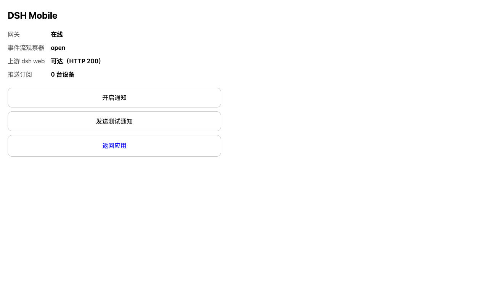
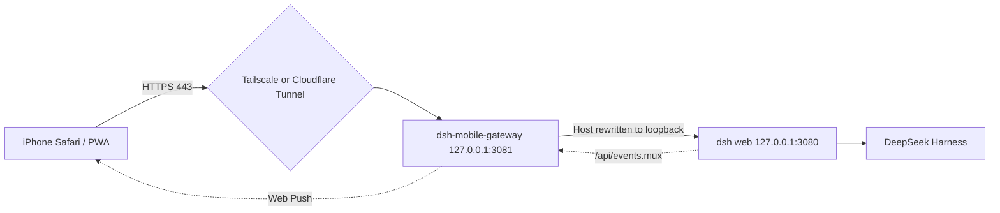

# dsh-iphone-mobile

Use a [DeepSeek Harness](https://github.com/deepseek-ai/deepseek-harness) instance running on your Mac from your iPhone —
approve tool calls, read streaming answers, and check background jobs while you are away from the desk.

No code, no sessions, no API keys leave the machine. The phone is only the control surface.

[中文说明](README.zh.md)



## Why this exists

A harness session can run for a long time and then stop on a single event: a tool call waiting for your approval.
If that happens while you are away from the keyboard, the whole run stalls.

The obvious fix — expose the web UI through a tunnel — does not work out of the box. The harness `/api` surface is
guarded by a browser-trust fence: the `Host` header must be a loopback authority (or one declared with
`--trusted-host`), and a browser `Origin` must match it. Traffic arriving through a tunnel carries the public
hostname, so it is answered with `403` before any RPC is dispatched. That fence is a reachability policy, not
authentication.

This project is the missing layer: a small gateway that speaks loopback to the harness, rewrites the upstream
`Host`, authenticates the public side, and adds a mobile PWA layer on top.

## What it is, and what it is not

- **It is** a gateway plus a mobile layer: reverse proxy, token auth, PWA manifest, safe-area CSS, push notifications.
- **It is not** a reimplementation of the harness UI. The GUI already ships conversation, files, terminal and jobs —
  and it already has narrow-viewport breakpoints. Duplicating that would be waste.
- **It is not** a hosted relay. There is no server of ours in the path. You own the tunnel.

## Architecture



The gateway does four things:

1. **Proxy** — forwards to the harness, rewriting `Host` to loopback and dropping `Origin`, so the fence passes
   without patching the harness. WebSocket upgrades are piped over a raw TCP connection with the handshake
   replayed, which is why there is no `ws` dependency.
2. **Authenticate** — a random token exchanged for an HttpOnly cookie, with per-source throttling on failed logins.
3. **Wrap in a PWA** — injects manifest, icons, Service Worker, safe-area CSS and a subscribe control into the
   served HTML. Nothing in the harness build is modified.
4. **Notify** — subscribes to the harness event stream and turns approval requests, questions, agent errors and
   settled jobs into push notifications.

## Features

- Remote access over Tailscale or Cloudflare Tunnel, with a single token to manage
- Installable PWA: standalone display, iOS icons, safe-area handling, 16px inputs (no auto-zoom)
- Push notifications for `approval/requested`, `question/requested`, `agent-error`, job settlement and turn end
- Deduplication: job frames are full snapshots, so only terminal-state transitions notify; `turn/end` dedupes by seq
- Self-healing: `404`/`410` push responses delete the dead subscription; the event watcher reconnects with backoff
- Mobile status page at `/m/status`: upstream health, subscription count, enable-notifications and a test push
- **Zero runtime dependencies** — Node built-ins only, including a hand-rolled RFC 8291 / RFC 8292 Web Push

## Quick start

Requirements: Node.js 22 or newer, and a running `dsh web` on `127.0.0.1:3080`.

```bash
# terminal 1 — the harness (defaults to loopback)
dsh web

# terminal 2 — the gateway
npm start

# the access token, generated on first run
cat ~/.dsh-mobile/token
```

Then, on the phone:

1. Open `https://<your-entry>/login?token=<token>` once to exchange it for a cookie.
2. Share sheet → **Add to Home Screen**.
3. Tap **开启通知** (enable notifications) — iOS requires the subscription to happen in a user gesture.

## Verification

Everything below runs offline and asserts behaviour rather than printing reassurance:

```bash
node scripts/selftest-gateway.mjs    # 28 assertions: auth, fence bypass, injection, WS upgrade, push round-trip
node scripts/selftest-webpush.mjs    # 11 assertions: VAPID signature, aes128gcm round-trip, tamper rejection, 410
node scripts/selftest-push.mjs       # 11 assertions: event-to-notification mapping and dedupe
node scripts/check-stream.mjs --selftest
```

The Web Push test is a real cryptographic round trip: it generates a subscriber key pair, points the sender at a
local fake push service, and decrypts the received body with the subscriber's private key.

## Exposing it safely

```bash
./scripts/setup-tailscale.sh                                 # private tailnet entry
DOMAIN=dsh.example.com ./scripts/setup-cloudflare-tunnel.sh   # public entry, add Access in front
```

Both scripts target the **gateway** on `3081`, deliberately. Pointing a tunnel at the harness directly reintroduces
the `403` fence problem and removes the authentication layer.

## Limitations

- The harness GUI has no URL routing, so a notification cannot deep-link to a specific session. Notifications carry
  the session identifier in their body and open the app root.
- If the tunnel is down you get neither the page nor notifications. Closing that gap needs a native shell with APNs
  (code is not written yet, and a free Apple developer account cannot enable the push entitlement).
- The Service Worker deliberately does not cache pages: the GUI content changes per session, and stale caches are
  worse than an empty shell offline.
- The gateway token is a single factor. Put Cloudflare Access (or equivalent) in front of any public entry.

## Layout

```text
server/    gateway (proxy + auth + PWA injection) and push service
public/    PWA assets: manifest, icons, Service Worker, mobile CSS, status page
scripts/   tunnel setup, stress injection, event-stream inspection, self-tests
docs/      design notes, integration manual, acceptance cases, roadmap
```

Design notes live in [docs/架构与协议.md](docs/架构与协议.md) (Chinese): the verified wire contracts, the resume
semantics of the event stream, and why the gateway is shaped this way.

## Security

See [SECURITY.md](SECURITY.md). The harness must stay bound to `127.0.0.1`; keys live in `~/.dsh-mobile` with
`0600` permissions and are never committed.

## License

MIT — see [LICENSE](LICENSE).
