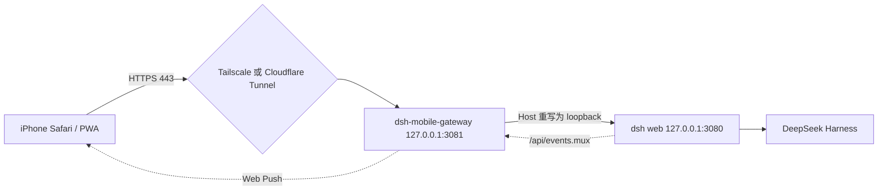

# dsh-iphone-mobile

在 iPhone 上使用跑在你 Mac 上的 [DeepSeek Harness](https://github.com/deepseek-ai/deepseek-harness)：
离开工位时也能批准工具调用、看流式回答、查后台任务。

代码、会话、API Key 都不离开本机，手机只作为控制面。

[English](README.md)


## 为什么需要它

一轮 harness 会话可能跑很久，然后因为一件事停下来：某个工具调用在等你批准。
如果这时候你不在电脑前，整轮就卡住了。

最直觉的做法——把 Web UI 通过隧道暴露出去——开箱即用是不成立的。harness 的 `/api` 有一层浏览器信任围栏：
`Host` 必须是 loopback 权威（或用 `--trusted-host` 声明的权威），浏览器带 `Origin` 时还必须与之匹配。
经隧道进来的流量携带的是公网主机名，于是在任何 RPC 派发之前就被 `403` 挡掉。
而这道围栏是可达性策略，不是鉴权。

本项目补的就是这一层：一个对 harness 说 loopback 的网关，它重写上游 `Host`、对外做鉴权，再叠加移动端 PWA 层。

## 它是什么，不是什么

- **它是** 网关加移动层：反向代理、令牌鉴权、PWA 清单、安全区样式、推送通知。
- **它不是** 对 harness 界面的重写。GUI 已有会话、文件、终端与任务，也已有窄屏断点；再写一套是浪费。
- **它不是** 托管中转。链路里没有我们的服务器，隧道是你自己的。

## 架构



网关做四件事：

1. **代理**：转发到 harness，把 `Host` 重写为 loopback 并删除 `Origin`，围栏无需改动 harness 一行即可通过。
   WebSocket 升级走原始 TCP 重放握手再双向管道，因此不需要 `ws` 依赖。
2. **鉴权**：随机令牌换取 HttpOnly Cookie，登录失败按来源限流。
3. **包一层 PWA**：向响应 HTML 注入清单、图标、Service Worker、安全区样式与订阅入口，不改 harness 产物。
4. **通知**：订阅 harness 事件流，把审批请求、提问、agent 报错与任务终态转成推送。

## 特性

- 经 Tailscale 或 Cloudflare Tunnel 远程访问，只需管理一个令牌
- 可安装 PWA：standalone 显示、iOS 图标、安全区适配、16px 输入字号（避免自动放大）
- 推送覆盖 `approval/requested`、`question/requested`、agent 报错、任务终态与轮次结束
- 去重：任务帧是全量快照，只在终态跃迁时通知；`turn/end` 按 seq 去重
- 自愈：推送返回 `404`/`410` 即删除失效订阅；事件观察器断线按指数退避重连
- 手机状态页 `/m/status`：上游健康、订阅数量、开启通知、发送测试推送
- **零运行时依赖**：只用 Node 内置模块，包括手写的 RFC 8291 / RFC 8292 Web Push 实现

## 快速开始

要求：Node.js 22 及以上，且 `dsh web` 正在 `127.0.0.1:3080` 运行。

```bash
# 终端 1 —— harness（默认只监听 loopback）
dsh web

# 终端 2 —— 网关
npm start

# 首次运行自动生成的访问令牌
cat ~/.dsh-mobile/token
```

然后在手机上：

1. 打开 `https://<你的入口>/login?token=<令牌>` 一次，换取 Cookie。
2. 分享菜单 → **添加到主屏幕**。
3. 点击 **开启通知** —— iOS 要求在用户手势中完成订阅。

## 验证方式

下面的脚本全部离线运行，断言行为而不是打印安慰性文字：

```bash
node scripts/selftest-gateway.mjs    # 28 项：鉴权、围栏代过、注入、WebSocket 升级、推送往返
node scripts/selftest-webpush.mjs    # 11 项：VAPID 签名、aes128gcm 往返、篡改拒绝、410
node scripts/selftest-push.mjs       # 11 项：事件到通知的映射与去重
node scripts/check-stream.mjs --selftest
```

Web Push 那组是真实的密码学往返：生成订阅端密钥对，让发送端指向本地假推送服务，
再用订阅端私钥把收到的密文解出来比对明文。

## 安全地对外暴露

```bash
./scripts/setup-tailscale.sh                                 # 私有 tailnet 入口
DOMAIN=dsh.example.com ./scripts/setup-cloudflare-tunnel.sh   # 公网入口，前面再加 Access
```

两个脚本都刻意指向**网关**的 `3081`。把隧道直接指向 harness 会重新踩到 `403` 围栏，同时失去鉴权层。

## 已知限制

- harness GUI 没有 URL 路由，通知无法深链到具体会话；通知正文里带会话标识，点击打开应用根路径。
- 隧道断开时既没有页面也没有通知。要补上这个缺口需要原生壳加 APNs（代码尚未编写，且免费 Apple 开发者账号无法开启推送权限）。
- Service Worker 刻意不缓存页面：GUI 内容随会话变化，陈旧缓存比离线空壳更糟。
- 网关令牌是单因子。任何公网入口前面都应再加 Cloudflare Access 或等效身份层。

## 目录结构

```text
server/    网关（代理 + 鉴权 + PWA 注入）与推送服务
public/    PWA 资产：清单、图标、Service Worker、移动端样式、状态页
scripts/   隧道接入、弱网注入、事件流观察、自测脚本
docs/      设计、接入手册、验收用例、路线图
```

设计与协议细节见 [docs/架构与协议.md](docs/架构与协议.md)：已核实的线上契约、事件流的续传语义，
以及网关为什么长成这样。

## 安全

见 [SECURITY.md](SECURITY.md)。harness 必须保持只监听 `127.0.0.1`；密钥存放在 `~/.dsh-mobile`，
权限 `0600`，永不入库。

## 许可证

MIT，见 [LICENSE](LICENSE)。
